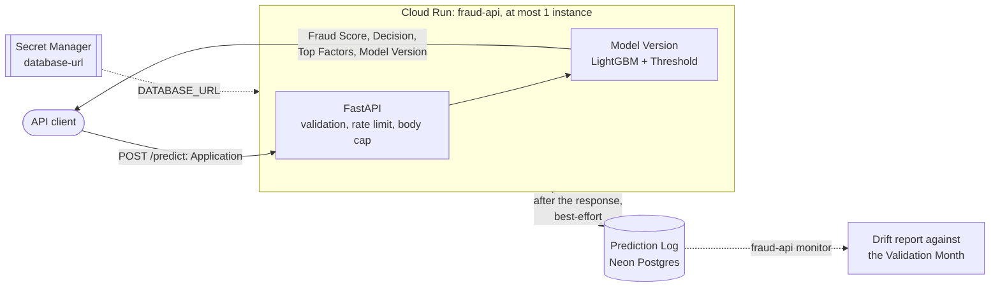
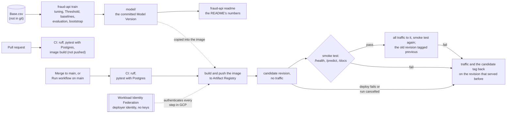
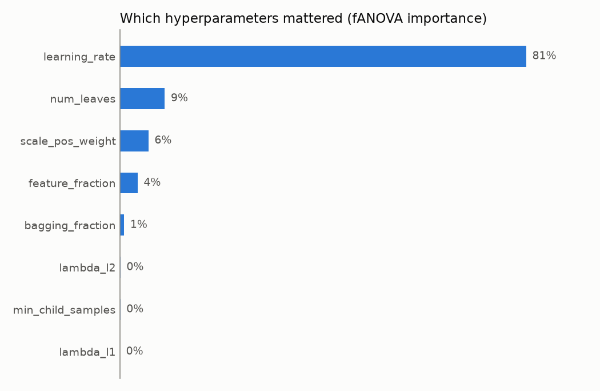

# Fraud API

A public API that scores bank account opening Applications for fraud risk. Send one Application, get back a Fraud Score, a Decision (`pass` or `review`), the Top Factors behind the score and the Model Version that made it. Behind it is a LightGBM model trained on the public [Bank Account Fraud (BAF)](https://github.com/feedzai/bank-account-fraud) dataset, served by FastAPI on Google Cloud Run. Every scored Application is logged to a Prediction Log in Postgres, best-effort: a database outage never blocks scoring.

<!-- generated:about -->
Model Version `lgbm-f5421b309a8c`, Threshold 0.1037.

**Try it:** open the live [`/docs`](https://fraud-api-r6bn3ptcuq-ew.a.run.app/docs), pick `POST /predict` → *Try it out* → *Execute*. Or from a terminal:
<!-- /generated:about -->

<!-- generated:curl -->
```bash
curl -s https://fraud-api-r6bn3ptcuq-ew.a.run.app/predict \
  -H 'Content-Type: application/json' \
  -d '{"income": 0.6, "name_email_similarity": 0.5, "prev_address_months_count": 20, "current_address_months_count": 60, "customer_age": 30, "days_since_request": 0.02, "intended_balcon_amount": 10.5, "payment_type": "AA", "zip_count_4w": 1500, "velocity_6h": 5000.0, "velocity_24h": 4800.0, "velocity_4w": 5000.0, "bank_branch_count_8w": 10, "date_of_birth_distinct_emails_4w": 8, "employment_status": "CA", "credit_risk_score": 120, "email_is_free": 1, "housing_status": "BA", "phone_home_valid": 0, "phone_mobile_valid": 1, "bank_months_count": 10, "has_other_cards": 0, "proposed_credit_limit": 500.0, "foreign_request": 0, "source": "INTERNET", "session_length_in_minutes": 5.0, "device_os": "linux", "keep_alive_session": 1, "device_distinct_emails_8w": 1}'
```

```json
{
  "fraud_score": 0.008908066429150555,
  "decision": "pass",
  "model_version": "lgbm-f5421b309a8c",
  "request_id": "…",
  "top_factors": [
    {
      "field": "housing_status",
      "value": "BA",
      "contribution": 0.9102531266329635
    },
    {
      "field": "prev_address_months_count",
      "value": 20.0,
      "contribution": -0.5999459034527709
    },
    {
      "field": "device_os",
      "value": "linux",
      "contribution": -0.3797511991667
    }
  ]
}
```
<!-- /generated:curl -->

A Fraud Score ranks Applications; it is not a probability. An Application is sent to `review` when its Fraud Score reaches the Threshold, chosen so that 5% of Legitimate Applications in the Validation Month would be. Send `null` for a value the Applicant did not provide, in the fields that may be missing (see [Data caveats](#data-caveats)); every field must be present, and every other field needs a value. Unknown categories, out-of-range values, and missing or extra fields get a 422 that names the field.

`top_factors` names the Top Factors: the three fields that moved this Fraud Score the most, largest first, with the Applicant's value. Each `contribution` is LightGBM's own TreeSHAP value (`pred_contrib`) in log-odds, the units of the model's raw score: positive pushes towards Review, negative towards Pass. Added to the model's expected value, all fields' contributions give the raw score, and its logistic transform is the Fraud Score. They explain this model's ranking, not what causes fraud.

The words used here (Application, Fraud Score, Threshold, Decision, Month…) are defined in [GLOSSARY.md](GLOSSARY.md).

## Architecture

Scoring one Application, and the Drift report read from the Prediction Log:



How a model and a commit reach production:



## How the model was built

The data has eight Months (0–7) and nothing finer, so the split is by Month ([ADR 0001](docs/adr/0001-split-by-month-without-refit.md)):

<!-- generated:split -->
| Months | Role |
|---|---|
| 0–4 | Training Months: the final model is fitted here. |
| 4 | Tuning Month: Optuna compares configurations trained on Months 0–3 here. |
| 5 | Validation Month: used only to choose the Threshold. |
| 6–7 | Test Months: scored once, after every choice was fixed. |
<!-- /generated:split -->

The model is not refitted on the Validation Month after the Threshold is chosen, because that would move the Fraud Scores away from the Threshold chosen for them. Two baselines get their own Thresholds by the same rule: a logistic regression (median imputation with missing indicators, scaling, one-hot) and a single-feature rule on `credit_risk_score`.

The trained model and its metadata are committed in [`model/`](model) ([ADR 0002](docs/adr/0002-model-artifact-committed-to-repo.md)), so one commit pins the code and the exact model it serves. Every result below is generated from [`model/metadata.json`](model/metadata.json) by `fraud-api readme`, and a test fails if the README drifts from it.

## Results

<!-- generated:test-results -->
Test Months 6–7: 205,011 Applications, 2,878 of them Fraudulent (1.4%). Each model uses its own Threshold, chosen on the Validation Month.

| Model | Recall@5%FPR | Recall at the Threshold | FPR at the Threshold | PR-AUC | FPR Ratio | Precision Ratio |
|---|---:|---:|---:|---:|---:|---:|
| LightGBM (served) | 55.0% (53.3–57.0) | 59.1% | 6.0% | 0.198 (0.183–0.213) | 0.32 (0.31–0.33) | 0.84 (0.77–0.92) |
| Logistic regression | 50.9% (49.1–52.7) | 50.0% | 4.8% | 0.163 (0.150–0.176) | 0.29 (0.28–0.31) | 0.79 (0.72–0.87) |
| `credit_risk_score` rule | 19.8% (18.2–21.3) | 19.8% | 4.9% | 0.037 (0.034–0.040) | 0.48 (0.46–0.50) | 0.58 (0.49–0.68) |
| LightGBM without `customer_age` (experiment) | 54.7% (52.9–56.7) | 57.9% | 5.9% | 0.194 (0.179–0.207) | 0.42 (0.41–0.44) | 0.70 (0.64–0.77) |

In brackets: 95% intervals from a paired bootstrap of the Test Months' Applications (1,000 resamples, every model on the same ones). Recall@5%FPR picks its own cut on each resample, as its definition says; the FPR Ratio and the Precision Ratio stay at each model's Threshold from the Validation Month. The intervals cover sampling noise in these Applications, not drift to later Months or a refit of the model.
<!-- /generated:test-results -->

- **Recall@5%FPR** is the share of Fraudulent Applications flagged when at most 5% of Legitimate Applications in these Months are flagged. It measures ranking quality.
- **Recall and FPR at the Threshold** are what the served model actually does with the Threshold chosen a Month earlier.
- **FPR Ratio** compares the two Age Groups (50 or over, under 50) at the Threshold: the lower group's false positive rate divided by the higher one's. 1 is parity. The BAF authors report about 0.3 for their best LightGBM models on this data.
- **Precision Ratio** compares the same two Age Groups at the Threshold from the other side: among flagged Applications, the lower group's share of Fraudulent ones divided by the higher one's. 1 means a Review carries the same fraud risk whatever the Applicant's age.

<!-- generated:validation-results -->
Validation Month 5: 119,323 Applications, 1,411 of them Fraudulent (1.2%). Optimistic: each Threshold was chosen on this Month, so FPR at the Threshold is at most 5% by construction (as close as ties in the scores allow).

| Model | Recall@5%FPR | Recall at the Threshold | FPR at the Threshold | PR-AUC | FPR Ratio | Precision Ratio |
|---|---:|---:|---:|---:|---:|---:|
| LightGBM (served) | 54.8% | 54.8% | 5.0% | 0.193 | 0.33 | 0.83 |
| Logistic regression | 50.7% | 50.7% | 5.0% | 0.158 | 0.32 | 0.83 |
| `credit_risk_score` rule | 19.3% | 19.3% | 4.9% | 0.031 | 0.46 | 0.61 |
| LightGBM without `customer_age` (experiment) | 53.9% | 53.9% | 5.0% | 0.192 | 0.44 | 0.70 |
<!-- /generated:validation-results -->

### Tuning

<!-- generated:tuning -->
50 TPE trials, each trained on Months 0–3 and scored on the Tuning Month 4. Recall@5%FPR on the Tuning Month: 54.3% with LightGBM defaults, 59.1% tuned (+4.8 points). LightGBM defaults were scored on the Tuning Month only, so this is the one like-for-like comparison, and the tuned figure is the best of 50 trials on that same Month, so part of the gain is selection. The final model uses the best trial's 646 trees. By fANOVA importance, the parameters that mattered most were `learning_rate` 81%, `num_leaves` 9%, `scale_pos_weight` 6%.
<!-- /generated:tuning -->



All trials are in [`reports/optuna_trials.csv`](reports/optuna_trials.csv).

### What the numbers say

<!-- generated:discussion -->
- **LightGBM against logistic regression.** On the Test Months, at 5% FPR, LightGBM flags 55.0% of Fraudulent Applications and logistic regression 50.9% (+4.1 points; the difference's interval is +2.9 to +5.4 points, which excludes zero); PR-AUC is 0.198 against 0.163. A well-preprocessed linear model gets most of the way; the single-feature rule flags 19.8%.
- **FPR Ratio between Age Groups.** At its Threshold, LightGBM's FPR Ratio on the Test Months is 0.32: Legitimate Applications from one Age Group are flagged about 3.1 times as often as from the other. Fraud rises with age (EDA section 6), and the model learns it. The BAF authors report about 0.3 for their best models; this model's FPR Ratio is published rather than hidden ([ADR 0003](docs/adr/0003-keep-age-as-feature-and-report-fpr-ratio.md)).
- **Precision Ratio between Age Groups.** At the same Threshold, the Precision Ratio is 0.84: among flagged Applications, the share that is Fraudulent in one Age Group is 0.84 times the share in the other. The two ratios measure different things: how evenly Legitimate Applicants are sent to Review, and whether a Review means the same fraud risk whatever the age. Fraud is more common in one Age Group, so a model can move one ratio towards 1 at the cost of the other.
- **Drift between Months.** The share of Fraudulent Applications rises from 1.0% in the Training Months and 1.2% in the Validation Month to 1.4% in the Test Months. The Threshold chosen for 5% FPR on the Validation Month flags 6.0% of Legitimate Applications on the Test Months, and 59.1% of Fraudulent ones. A real deployment would re-choose the Threshold on recent data.
<!-- /generated:discussion -->

Age is a feature on purpose ([ADR 0003](docs/adr/0003-keep-age-as-feature-and-report-fpr-ratio.md)). Several other fields carry part of the age signal (EDA section 7), so dropping it was expected to leave much of the gap between Age Groups in place while costing recall.

<!-- generated:without-age -->
Measured, in the row *LightGBM without `customer_age`* above: the same LightGBM with the served model's parameters and tree count, minus the one feature. On the Test Months, dropping age changes Recall@5%FPR by -0.3 points (about 9 of 2,878 Fraudulent Applications) and PR-AUC from 0.198 to 0.194, and it raises the FPR Ratio from 0.32 to 0.42: one Age Group's Legitimate Applications are still flagged about 2.4 times as often as the other's; it also lowers the Precision Ratio from 0.84 to 0.70. Paired over the same bootstrap resamples, the change in Recall@5%FPR is -1.2 to +0.6 points, which includes zero; in PR-AUC, -0.008 to -0.001, which excludes zero; in the FPR Ratio, +0.098 to +0.114, which excludes zero; and in the Precision Ratio, -0.163 to -0.115, which excludes zero. That is still one fit with one seed, with parameters tuned with age.
<!-- /generated:without-age -->

The developer reviewed these numbers for Model Version `lgbm-f5421b309a8c` on 8 November 2026 and kept age as a feature. On 10 November 2026 they set the test that decides it: age stays if it makes a Review carry a more equal fraud risk across Age Groups, measured by the Precision Ratio, and goes otherwise. With age the Precision Ratio is higher, and the paired interval of the difference excludes zero (paragraph above), so age stays a feature (ADR 0003). There is no separate Threshold per Age Group either: that would treat Applicants differently because of their age.

The [EDA notebook](notebooks/eda.ipynb) shows the data behind these choices; each section ends with the decision it led to.

## Data caveats

- **Synthetic data.** BAF is a synthetic dataset generated from real bank account opening data, with privacy noise added. Its [datasheet](https://github.com/feedzai/bank-account-fraud/blob/main/documents/datasheet.pdf) says it is meant for research and benchmarking, not for building real-world fraud models. This project is a demonstration of the engineering around a model, not a fraud model to deploy.
- **Missing values.** The dataset encodes missing values as -1 in five columns (`prev_address_months_count`, `current_address_months_count`, `bank_months_count`, `session_length_in_minutes`, `device_distinct_emails_8w`). Negative `intended_balcon_amount` values are the same sentinel blurred by the privacy noise. All of these become real missing values before the model sees them, and the API takes `null` for them, so clients never send dataset-specific sentinel numbers. Missingness itself carries signal, and LightGBM uses it directly.
- **No data in the repository.** `Base.csv` is not committed, because its redistribution terms are not stated. The reference Applications and test data are synthetic.

## Threat model

The API is public and unauthenticated by design, so a reviewer can try it in a minute. These are the risks that follow from that, and what bounds them.

- **Abuse and cost.** Each revision is capped at one instance with 1 vCPU and 512 MiB ([`deploy.yml`](.github/workflows/deploy.yml)). Busy around the clock, one instance uses about 2.6 million vCPU-seconds a month, roughly $45 a month in compute at [Cloud Run's instance-based prices](https://cloud.google.com/run/pricing) (Tier 1, after the free tier). Two revisions are reachable: the live one, and the rollback target through its `previous` tag URL. So the compute ceiling is about **$90 a month**.
- **Outbound traffic has no ceiling.** It is billed at about $0.12 per GiB. The largest public response, `/openapi.json`, is under 8 KB, so a million requests for it cost under a dollar, but a sustained flood has no upper bound. Two things answer that:
  - a GCP budget emails the owner at 50% and 100% of a small monthly amount;
  - the kill switch below takes the service off the internet in seconds. There is no automatic billing shutdown.
<!-- generated:limits -->
- **Rate limit.** `/predict` allows 60 requests a minute per client, with a 429 and `Retry-After` past that; request bodies over 4,096 bytes get a 413 before they are parsed. The client is the last `X-Forwarded-For` hop, the address Cloud Run saw; earlier hops are client-supplied and ignored, so a forged header doesn't escape the limit. The limit is per address: it slows one client, not a distributed attack, and an IPv6 client can rotate addresses within its /64. It is kept in memory, which is enough for one instance.
<!-- /generated:limits -->
- **Model extraction does not matter here.** The model file is already public in this repository, and it was trained on public synthetic data. Querying the API reveals nothing that `git clone` doesn't.
- **Secrets.**
  - The Postgres connection string lives only in Secret Manager. Besides the project owner, only the service's runtime identity can read it, and the deploy workflow never handles it.
  - GitHub Actions deploys through Workload Identity Federation, pinned to this repository, with short-lived tokens; no service-account key exists.
  - GitHub push protection blocks committed secrets.
- **Personal data.** The Prediction Log stores the Application, the Fraud Score, the Decision, the Top Factors and the latency. It stores no IP addresses or headers.

## Operations

The service runs as `fraud-api` in project `fraud-api-g2z9q`, region `europe-west1`. Every merge to `main` runs the checks, then the deploy:

1. builds and pushes the image;
2. deploys it as a new revision with no traffic, tagged `candidate`;
3. smoke-tests that revision ([`scripts/smoke_test.py`](scripts/smoke_test.py));
4. only then moves all traffic to it, tags the revision that served before `previous`, and smoke-tests again.

If any step fails, or the run is cancelled, the deploy puts traffic and the `candidate` tag back on the revision that served before. So `candidate` always names the last revision that passed, and `previous` the one before it. The very first deploy, which created the service, had nothing to fall back on. *Actions → Deploy → Run workflow* redeploys `main` without a commit.

**Kill switch:** make the service internal-only. It stops answering the internet at once:

```bash
gcloud run services update fraud-api --project fraud-api-g2z9q --region europe-west1 --ingress internal
```

To reopen it, run the same command with `--ingress all`.

**Rollback:** send all traffic to the revision that served before the last deploy:

```bash
gcloud run services update-traffic fraud-api --project fraud-api-g2z9q --region europe-west1 --to-tags previous=100
```

To go forward again, run the same command with `--to-tags candidate=100`. Artifact Registry keeps the images of the last ten deploys, failed ones included, so the `previous` revision can start unless nine deploys in a row have failed since.

**Monitoring:** compare each day of the Prediction Log with the Validation Month, the Month the Threshold was chosen on. The report shows, per day:
- the Applications scored;
- the share sent to Review, next to the share the Threshold sent there in the Validation Month;
- the mean Fraud Score;
- the features whose population stability index passes the usual warning level.

The Model Version's reference Applications are left out: the post-deploy smoke test sends them, and the `/docs` example is one of them. The connection string is read from Secret Manager into this one command's environment:

```bash
DATABASE_URL="$(gcloud secrets versions access latest --secret database-url --project fraud-api-g2z9q)" uv run fraud-api monitor --days 7
```

Nothing reads the Prediction Log over HTTP; the report runs wherever the connection string is available.

## Run it locally

You need [uv](https://docs.astral.sh/uv/) and Python 3.12; Docker is optional.

```bash
uv sync                                    # dependencies, including dev and train
git config core.hooksPath .githooks        # the commit-msg hook
uv run pytest                              # the tests; an embedded Postgres starts if TEST_DATABASE_URL is unset
uv run fraud-api serve                     # the committed Model Version on http://localhost:8000/docs
```

To retrain, download `Base.csv` and run the pipeline. Download needs a [Kaggle API token](https://www.kaggle.com/docs/api), and the file's SHA-256 is checked. The pipeline runs tuning, the final fit, the Threshold, the baselines and the one evaluation on the Test Months:

```bash
uv run --group kaggle fraud-api download   # into data/
uv run fraud-api train                     # rewrites model/ and reports/
uv run fraud-api readme                    # regenerates the numbers in this README
```

The same seed reproduces the same Model Version. Without `DATABASE_URL` the Prediction Log is off; with it, the table is created on first start.

In a container:

```bash
docker build -t fraud-api .
docker run --rm -p 8080:8080 -e PORT=8080 fraud-api
```

## More

- [GLOSSARY.md](GLOSSARY.md): the domain vocabulary.
- Architecture decisions:
  - [0001 Split by Month, no refit after the Threshold](docs/adr/0001-split-by-month-without-refit.md)
  - [0002 Commit the trained model](docs/adr/0002-model-artifact-committed-to-repo.md)
  - [0003 Keep age as a feature, report the FPR Ratio and the Precision Ratio](docs/adr/0003-keep-age-as-feature-and-report-fpr-ratio.md)
- [EDA notebook](notebooks/eda.ipynb)
- CI: [`.github/workflows/ci.yml`](.github/workflows/ci.yml) (PRs: ruff, pytest against Postgres, image build). Deploy: [`.github/workflows/deploy.yml`](.github/workflows/deploy.yml).
- Cloud setup, reproducible: [`scripts/provision.sh`](scripts/provision.sh).
